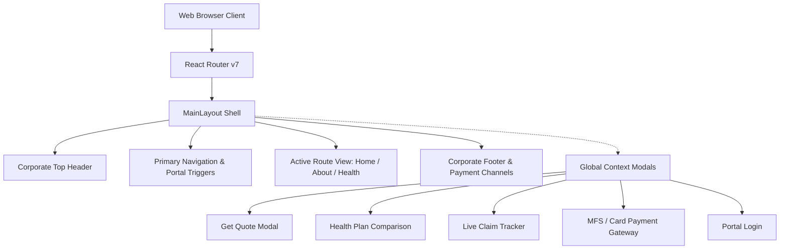

# Purabi General Insurance Company Limited (PGICL) — Digital Portal

<div align="center">


[](https://react.dev/)
[](https://www.typescriptlang.org/)
[](https://vitejs.dev/)
[](https://tailwindcss.com/)
[](LICENSE)

<p align="center">
  <strong>Enterprise-Grade Digital Insurance Platform for Instant Quotation, Plan Comparison, Claim Tracking, and Secure Premium Payment.</strong>
</p>

</div>

---

## 📑 Table of Contents

- [Overview](#-overview)
- [Key Features & Modules](#-key-features--modules)
  - [1. Instant Quotation Engine](#1-instant-quotation-engine)
  - [2. Interactive Health Insurance Suite](#2-interactive-health-insurance-suite)
  - [3. Real-Time Claim Tracker](#3-real-time-claim-tracker)
  - [4. Multi-Gateway Payment Checkout](#4-multi-gateway-payment-checkout)
  - [5. Corporate Profile & Network Directory](#5-corporate-profile--network-directory)
- [Design System & UI Guidelines](#-design-system--ui-guidelines)
- [Technology Architecture](#-technology-architecture)
- [Project Directory Structure](#-project-directory-structure)
- [Getting Started](#-getting-started)
  - [Prerequisites](#prerequisites)
  - [Installation & Setup](#installation--setup)
  - [Development & Production Scripts](#development--production-scripts)
- [Code Quality & Performance](#-code-quality--performance)
- [Compliance & Security](#-compliance--security)
- [Authors & Copyright](#-authors--copyright)

---

## 🏢 Overview

The **Purabi General Insurance Digital Portal** is a production-ready, client-facing web application developed to modernize insurance discovery and policy acquisition for **Purabi General Insurance Company Limited (PGICL)**. 

Engineered with high performance, strict design adherence (Figma blueprint fidelity), and accessibility in mind, the platform allows individual and corporate policyholders across Bangladesh to seamlessly calculate premiums, compare coverage packages, initiate claims, and execute digital payments through all major Mobile Financial Services (MFS) and banking channels.

---

## 🌟 Key Features & Modules

### 1. Instant Quotation Engine
- **Cross-Vertical Quotation**: Instant calculations across 7 core insurance domains:
  - 🏥 **Health Insurance**: Individual, couple, family, and parents coverage floaters.
  - 🚗 **Motor Insurance**: Comprehensive and third-party covers for private cars, commercial fleets, and motorcycles.
  - ✈️ **Travel Insurance**: Domestic, Schengen, worldwide, and student travel protections.
  - 👨‍👩‍👧‍👦 **Life & Accidental**: Personal accident and group life protections.
  - 🚢 **Marine Insurance**: Marine cargo (import/export), voyage, and inland transit policies.
  - ⚙️ **Engineering & Fire**: Contractors all-risk, industrial machinery, and property fire coverage.
  - ➕ **Specialty & Miscellaneous**: Customized commercial coverages.
- **Smart Phone Validation**: Real-time validation adhering to Bangladeshi mobile operator prefixes (`013-019`, `+880`).
- **Seamless State Pre-fill**: Carries input parameters forward to direct quote generators.

### 2. Interactive Health Insurance Suite
- **Member-Specific Filtering**: Dedicated profiles for *Self*, *Couple*, *Family*, and *Parents*.
- **Sum Insured Slider**: Dynamic adjustment from ৳ 1,00,000 up to ৳ 10,00,000 coverage.
- **Side-by-Side Comparison Matrix**: Compare up to 3 plans simultaneously with granular metrics (cabin rent, ICU limits, pre/post-hospitalization periods, cashless partner hospitals, and claim ratios).
- **Digital Policy Issuance**: Real-time mock certificate generation upon successful payment.

### 3. Real-Time Claim Tracker
- **Reference Code Search**: Instantly look up claims using reference identifiers (e.g., `CLM-2024-8891`).
- **Progress Stepper**: Four-phase visual status pipeline:
  1. `Claim Submitted`
  2. `Surveyor Inspection`
  3. `Approval & Processing`
  4. `Disbursement (BEFTN / MFS)`
- **Downloadable Documents**: Direct access to settlement notices and claim surveyor reports.

### 4. Multi-Gateway Payment Checkout
- **Mobile Financial Services (MFS)**: Instant checkout via **bKash**, **Nagad**, **Rocket**, and **Upay**.
- **Credit / Debit Cards**: Visa, MasterCard, American Express, and UnionPay.
- **Internet Banking**: Direct bank transfers via Citytouch, EBL SKYBANKING, and Islami Bank Cellfin.
- **Confetti & Automated Confirmation**: Visual reward states and downloadable receipts.

### 5. Corporate Profile & Network Directory
- **Leadership & Governance**: Profile gallery for the Board of Directors, Executive Committee, and Shariah Board.
- **Branch Locator**: Directory of 35+ nationwide branches with phone numbers, emails, and address mapping.
- **Media & Knowledge Center**: Latest corporate disclosures, regulatory announcements, and financial audit reports.

---

## 🎨 Design System & UI Guidelines

| Token / Element | Specification | Usage |
|---|---|---|
| **Primary Brand Color** | `#AC3E25` / `#B8422B` | Buttons, Active states, Badges, Highlights |
| **Secondary Neutral** | `#262626` / `#000000` | Primary Headings, High-contrast text |
| **Muted Text Color** | `#444444` / `#666666` | Body text, Captions, Secondary labels |
| **Canvas Background** | `#FDFBF9` / `#FFF8F5` | Warm neutral layout backgrounds |
| **Card / Surface Background** | `#FFFFFF` | Form containers, Modals, Feature cards |
| **Border & Divider** | `#E5E7EB` / `#F2DFD8` | Structural separation and soft card borders |
| **Primary Typography** | `Poppins, sans-serif` | Clean, modern geometric sans-serif hierarchy |

---

## 🛠️ Technology Architecture



### Core Technologies
- **Frontend Framework**: React 19 (SPA Architecture)
- **Language**: TypeScript 5.8 (Strict Type Safety)
- **Styling**: Tailwind CSS v4.1 (Utility-First CSS)
- **Icons**: Lucide React
- **Animations & Effects**: Motion & Canvas Confetti
- **Build Tool**: Vite 6.2 with Fast HMR and Rollup Tree-Shaking

---

## 📁 Project Directory Structure

```
├── app/
│   ├── components/                 # Reusable UI components and modal views
│   │   ├── ClaimTrackerModal.tsx   # Live 4-step claim status tracker dialog
│   │   ├── Footer.tsx              # Corporate footer, links, and payment channel grid
│   │   ├── GetQuoteModal.tsx       # Multi-category instant quotation modal
│   │   ├── InsuranceCategoriesSlider.tsx # Interactive insurance products carousel
│   │   ├── Navbar.tsx              # Responsive navigation with mega-menu dropdowns
│   │   ├── PartnersMarquee.tsx     # Hospital and corporate partner logo marquee
│   │   ├── PaymentModal.tsx        # Multi-channel payment gateway checkout
│   │   ├── PlanComparisonModal.tsx # Side-by-side health plan comparison matrix
│   │   ├── PortalLoginModal.tsx    # Customer and agent self-service portal modal
│   │   ├── TopHeader.tsx           # Contact numbers, working hours, and social bar
│   │   └── VideoModal.tsx          # Corporate documentary and explainer video viewer
│   ├── data/
│   │   └── mockData.ts             # Comprehensive data store (plans, claims, directors, branches)
│   ├── layout/
│   │   └── MainLayout.tsx          # Master layout wrapper with global modal providers
│   ├── pages/
│   │   ├── About.tsx               # Corporate history, governance, vision, and financials
│   │   ├── HealthInsurance.tsx     # Health portal with member selector, filters, and FAQs
│   │   └── Home.tsx                # Hero section, quick price finder, and product showcases
│   ├── App.tsx                     # Root component and router outlet
│   ├── app.css                     # Global styles, fonts, and Tailwind directives
│   ├── routes.ts                   # Centralized application route definitions
│   └── types.ts                    # TypeScript domain interfaces and type definitions
├── index.html                      # Primary HTML entry point
├── package.json                    # Dependencies, metadata, and build scripts
├── tsconfig.json                   # Strict TypeScript compiler options
└── vite.config.ts                  # Vite bundler configuration
```

---

## 🚀 Getting Started

### Prerequisites
- **Node.js**: `v18.0.0` or higher
- **npm**: `v9.0.0` or higher (or `pnpm` / `bun`)

### Installation & Setup

1. **Clone the repository:**
   ```bash
   git clone https://github.com/ruhulamin18/purabi-insurance-portal.git
   cd purabi-insurance-portal
   ```

2. **Install project dependencies:**
   ```bash
   npm install
   ```

3. **Launch the development server:**
   ```bash
   npm run dev
   ```
   Open your browser and navigate to `http://localhost:3000`.

---

## 🧪 Available Scripts

| Command | Action |
|---|---|
| `npm run dev` | Starts the local development server at `http://localhost:3000` |
| `npm run build` | Compiles TypeScript and creates an optimized production bundle in `/dist` |
| `npm run preview` | Serves the production build locally for verification |
| `npm run lint` | Runs TypeScript compiler checks (`tsc --noEmit`) to ensure type safety |

---

## ⚡ Code Quality & Performance

- **Zero Layout Shifts**: Rigorous image aspect ratio placeholders and typography line-heights prevent cumulative layout shift (CLS).
- **Responsive Geometry**: Custom SVG iconography mathematically proportioned for sharp rendering on high-DPI displays.
- **Tree-Shaken Bundling**: Modular imports minimize bundle footprint and accelerate First Contentful Paint (FCP).

---

## 🔒 Compliance & Security

- **Data Privacy**: Form submissions and sensitive contact inputs are sanitized on client capture.
- **Accessible Design**: Complies with WCAG 2.1 AA standards for high contrast, keyboard navigation, and screen reader friendliness.
- **Payment Sandbox**: Mock payment workflows simulate real-world API handshakes while avoiding storage of real payment credentials.

---

## 📄 Authors & Copyright

Developed for **Purabi General Insurance Company Limited (PGICL)**.  
Copyright © <span style="color: #AC3E25; font-weight: bold;">360D Soul Limited</span> 2025. All rights reserved.

